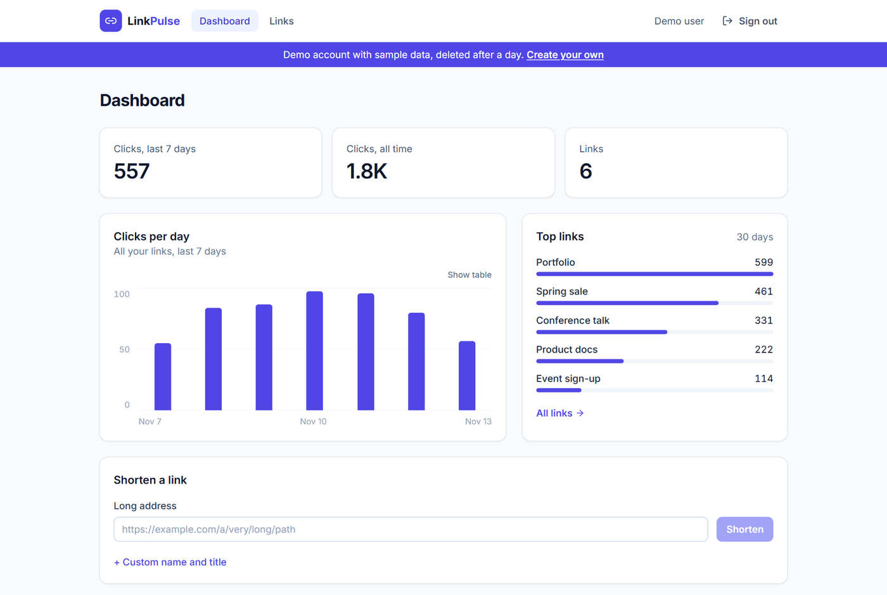
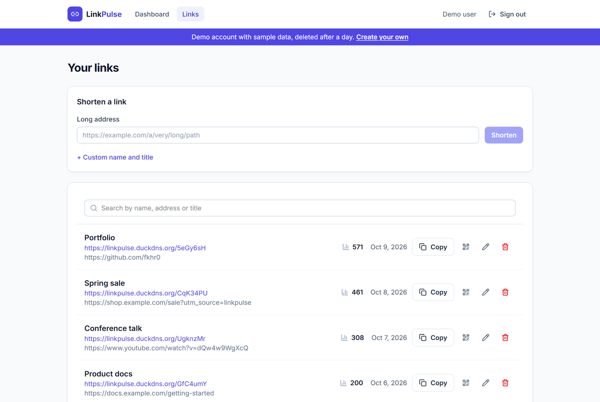
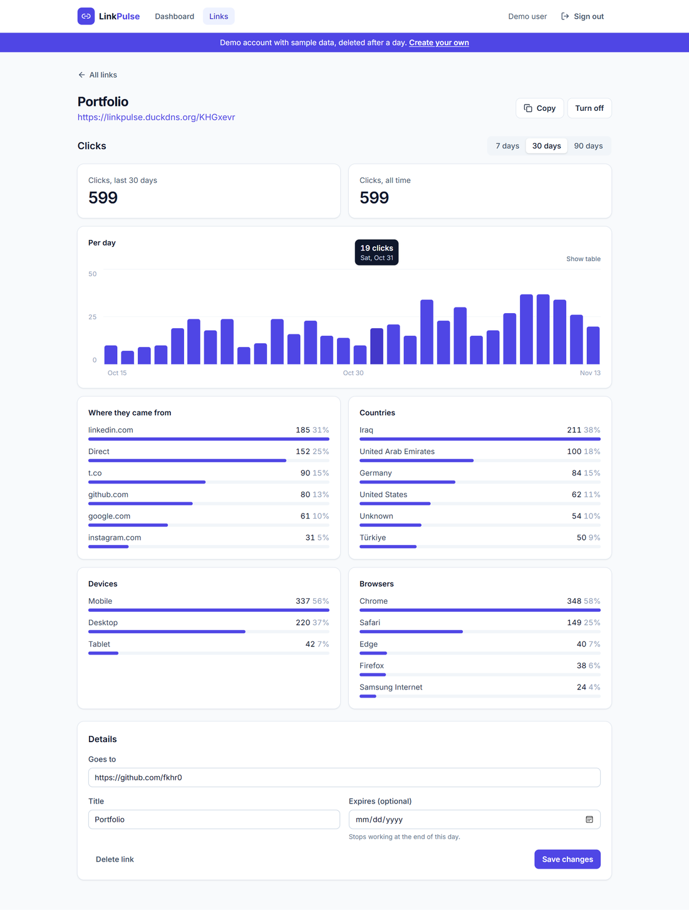

# LinkPulse

Short links with live click analytics: paste a long link, get a short one, and see
who clicks it, when, and from where.

**Live:** [linkpulse.duckdns.org](https://linkpulse.duckdns.org), "Try the demo" opens a
demo account with sample data (no sign-up).



| Your links | One link |
|---|---|
|  |  |

## Features

- Short links with a random code or a custom name, title and expiry; copy, QR code (PNG), turn off, edit, delete
- Redirects (302) served from a cache; clicks recorded in the background
- Dashboard: clicks per day, totals, top links
- Per link: 7 / 30 / 90 days, referrers, countries, devices, browsers; chart with keyboard access and a table view
- Accounts with cookie sessions; a separate demo account per visitor, deleted after a day

## Stack

| Part | Tech |
|---|---|
| Web | React 19, TypeScript, Vite, Tailwind CSS, TanStack Query, React Router |
| API | Node.js, TypeScript, Express 5, Zod |
| Data | PostgreSQL (Neon), Redis |
| Tests | Vitest, Testing Library, Supertest, Playwright |
| Ops | Docker, Nginx, GitHub Actions, AWS (arm64), Tailscale |

```
browser ──https──► nginx ──► linkpulse container ─┬─ /api/*   JSON API
                                                   ├─ /, /links… web app
                                                   └─ /:code    302 + click
                                   redis (cache) · postgres (links, clicks)
```

## Notes

- Session token in an HttpOnly, SameSite=Lax cookie; only its SHA-256 is stored. Writes from other origins are refused.
- Passwords with scrypt; sign-in rate limited; every query scoped to the user.
- Redirect targets cached in Redis, unknown codes too; edits clear the cache entry.
- Clicks buffered in memory and written every 2 s in one statement; no IP addresses stored, referrer as host only, bots skipped.
- PGlite (Postgres in WebAssembly) for tests and local runs, the same SQL as production.
- One image serves the web app, the API and the redirects; deploys roll back if the new container isn't healthy.

## Run it

```bash
npm install
npm run dev:api     # http://localhost:4000 (in-memory database without DATABASE_URL)
npm run dev:web     # http://localhost:5173
```

## Checks

```bash
npm run lint
npm run typecheck
npm test
npm run build -w apps/web && npm run e2e
```

---

© 2026 Fakhruddien Abbas · All rights reserved.
